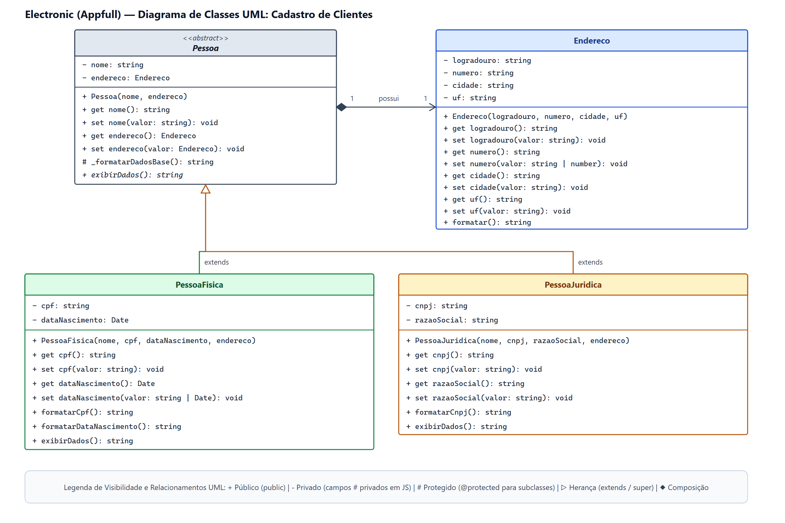

# Electronic - Cadastro de Clientes 

Módulo de cadastro de clientes (pessoas físicas e jurídicas) de um e-commerce de eletrônicos, em **JavaScript orientado a objetos**.

## Identificação do estudante

- **Estudante:** Mateus Gomes Neri
- **GitHub:** [mateusnriy](https://github.com/mateusnriy)
- **Unidade Curricular:** Programação Orientada a Objetos
- **Atividade:** Avaliação 01 - Cadastro de Clientes (Electronic / Appfull)

## Como executar

Requisito: Node.js 18+ (testado na v24).

```bash
node index.js     # executa os cenários de cadastro
node --test       # executa os testes automatizados
```

## Estrutura

| Caminho | Descrição |
| --- | --- |
| `docs/diagrama-classes.drawio` | Diagrama UML editável (Draw.io) |
| `docs/diagrama-classes.png` / `.pdf` | Exportações do diagrama |
| `src/Endereco.js` | Classe `Endereco` |
| `src/Pessoa.js` | Classe base abstrata `Pessoa` |
| `src/PessoaFisica.js` | `PessoaFisica extends Pessoa` |
| `src/PessoaJuridica.js` | `PessoaJuridica extends Pessoa` |
| `src/utils/validacoes.js` | Funções de validação reutilizadas |
| `index.js` | Cenários, `try/catch` e listagem final |
| `tests/cadastro.test.js` | Testes automatizados |

## Diagrama de classes



Convenção de visibilidade: `-` privado (campos `#` em JS), `+` público, `#` protegido (`_formatarDadosBase()`, convenção `_` em JS, pois JavaScript não possui `protected` nativo).

## Decisões de projeto

- **Herança:** `PessoaFisica` e `PessoaJuridica` usam `extends` e `super(nome, endereco)`. `Pessoa` é abstrata (`new.target`).
- **Composição:** toda `Pessoa` possui um `Endereco`.
- **Encapsulamento:** todos os atributos são campos privados (`#`) com `get`/`set`; os construtores atribuem via setters, então nenhum objeto nasce inválido.
- **Validações** (lançam `Error` com `throw`): nome ≥ 3 caracteres; CPF 11 e CNPJ 14 dígitos (`.`, `-` e `/` ignorados); data de nascimento real e não futura; razão social obrigatória; endereço completo com UF válida.
- **Polimorfismo:** `exibirDados()` sobrescrito em cada subclasse.
- **Tratamento de erros:** `index.js` captura cada falha com `try/catch`, informa o usuário e continua; a lista final contém só cadastros válidos.

## Evidências de teste

Saída real de `node index.js`. Cenários: PF válida (1), PJ válida (2), PF inválida (3a–3d), PJ inválida (4a–4b) e alteração inválida via setter (5).

```text
=== Cadastro de clientes - Electronic (Appfull) ===

>>> Cenário 1 - Pessoa Física válida
    OK: cadastro realizado com sucesso.

>>> Cenário 2 - Pessoa Jurídica válida
    OK: cadastro realizado com sucesso.

>>> Cenário 3a - Pessoa Física inválida (nome com 2 caracteres)
    ERRO: cadastro rejeitado -> Nome deve ter ao menos 3 caracteres.

>>> Cenário 3b - Pessoa Física inválida (CPF com 10 dígitos)
    ERRO: cadastro rejeitado -> CPF deve ter 11 dígitos, mas possui 10.

>>> Cenário 3c - Pessoa Física inválida (data de nascimento no futuro)
    ERRO: cadastro rejeitado -> Data de nascimento não pode estar no futuro.

>>> Cenário 3d - Pessoa Física inválida (data inexistente 31/02/2000)
    ERRO: cadastro rejeitado -> Data de nascimento não existe no calendário.

>>> Cenário 4a - Pessoa Jurídica inválida (razão social vazia)
    ERRO: cadastro rejeitado -> Razão social não pode ser vazio.

>>> Cenário 4b - Pessoa Jurídica inválida (CNPJ com 13 dígitos)
    ERRO: cadastro rejeitado -> CNPJ deve ter 14 dígitos, mas possui 13.

>>> Cenário 5 - Alteração inválida via setter em cliente já cadastrado
    ERRO: alteração rejeitada -> Nome deve ter ao menos 3 caracteres.
    Nome preservado: Maria Souza

=== Clientes cadastrados com sucesso: 2 ===

#1 [Pessoa Física]
  Nome: Maria Souza
  Endereço: Rua das Flores, 120 - São Paulo/SP
  CPF: 123.456.789-01
  Nascimento: 15/03/1990

#2 [Pessoa Jurídica]
  Nome: Electronic Atacado
  Endereço: Av. Paulista, 1000 - São Paulo/SP
  CNPJ: 12.345.678/0001-90
  Razão social: Electronic Comércio de Eletrônicos LTDA
```

Saída de `node --test`:

```text
✔ PF válida: normaliza CPF e herda de Pessoa
✔ PJ válida: normaliza CNPJ e herda de Pessoa
✔ Pessoa é abstrata
✔ PF inválida: nome, CPF, data e endereço
✔ PJ inválida: CNPJ e razão social
✔ Data de nascimento: bissexto válido e hoje aceito
✔ Endereço: campos obrigatórios e UF
✔ Encapsulamento: setters validam e getter de data devolve cópia
✔ Polimorfismo: exibirDados nas subclasses
ℹ tests 9
ℹ pass 9
ℹ fail 0
```

